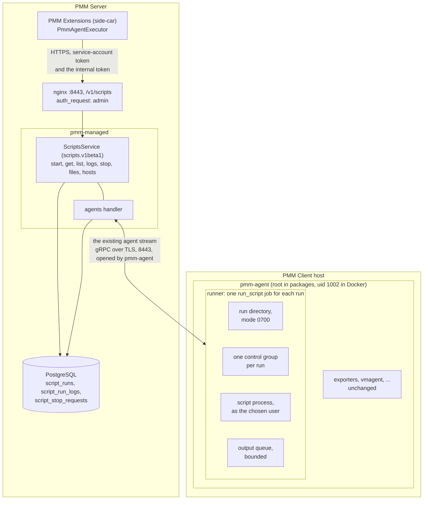
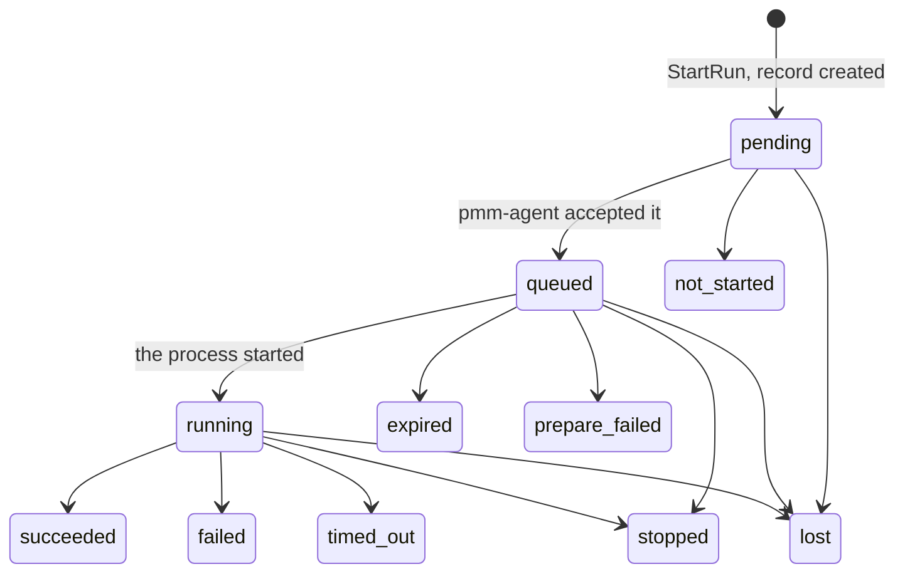

# Script runs in pmm-agent: analysis and design (PMM-15976)

- **Date:** 2026-11-18
- **Epic:** [PMM-15976](https://perconadev.atlassian.net/browse/PMM-15976). It follows the spike [PMM-15696](https://perconadev.atlassian.net/browse/PMM-15696), "Choose a replacement for Nomad in PMM Extensions task execution".
- **Code base:** percona/pmm `main` at `122590fc6` (2026-11-18, 3.11.0 in development) and percona/pmm-extensions `main` at `285f3c96dc`. Line numbers refer to those commits; re-check them before you edit, because both move.
- **Prototype:** branch `PMM-15696-proto` in percona/pmm, three commits on `016153c7a` ([percona/pmm#6414](https://github.com/percona/pmm/pull/6414)). It is a reference only: [§7](#7-what-the-prototype-is-and-what-changes) lists what is kept and what is redesigned.
- **Plans that implement this document:** [`plans/00-roadmap.md`](plans/00-roadmap.md) and plans 01 to 07 next to it.

Marks used below:
- **[V]** means verified by reading the code, or measured in the spike.
- **[I]** means inferred, or taken from upstream documentation, and not run.
- **[D]** means a design choice of this document that the prototype does not have. Nothing marked [D] has been built or tested.

Terms:
- A **run** is one execution of one script on one host.
- A **host** is a PMM node with a pmm-agent on it.
- **The caller** is PMM Extensions, the only client of the new API.

---

## 1. Summary

PMM Extensions runs its tasks (backups, MongoDB operations, diagnostics scripts) on PMM Client hosts through HashiCorp Nomad. PMM ships a Nomad server inside PMM Server and a Nomad client beside every pmm-agent. On 2026-11-17 the spike's results were reviewed and the replacement was chosen: **PMM's own pmm-agent runs the scripts, and Nomad leaves PMM** ([ADR-01](adr/ADR-01-pmm-agent-replaces-nomad.md)).

**What gets built.**
- **pmm-agent** gets a new job type, `run_script`. It starts one process on the host, sends its output and its result to PMM Server over the stream the agent already holds, and stops it on request. Each run gets its own control group where the host allows it.
- **pmm-managed** gets a run record, an API under `/v1/scripts` that only PMM Extensions can call, a check of open runs every time an agent reconnects, and retention.
- **PMM Extensions** gets a new executor that calls that API. Its four task kinds, its schedules and its history keep working.
- **Nomad** is deprecated in the release that ships the above, and removed in the one after: the server, the client on every host, the binary in PMM Client, the `/nomad/` endpoint, port 4647.

**What a database host gains and loses.** It gains nothing: no new process, port, package or runtime [V]. Three lines are added to PMM Client's systemd unit [D]. It loses the Nomad client, which holds 96 to 105 MiB at rest and about 52 to 68 MiB more for each run in flight ([§4](#4-what-the-spike-measured)) [V].

**What changes for people who run PMM.**
- Tasks no longer need `PMM_ENABLE_NOMAD`, a public address, or port 4647 published.
- A run happens at most once. Today a script can run twice, or be cut short, while its record reads success ([§3.3](#33-what-today-gets-wrong)).
- A host's owner can switch script runs off on that host, in `pmm-agent.yaml`. The server cannot override it.

**Target release:** PMM 3.12.0, planned for January 2027, with every case T1 to T26 of [§11](#11-tests) passed. Nomad is removed in the release after it ([ADR-14](adr/ADR-14-mixed-versions-and-nomad-removal.md)).

**Decisions:** [§12](#12-decisions). ADR-01 records the choice made on 2026-11-17. ADR-02 to ADR-14 are Proposed and wait for the review of this folder.

---

## 2. Sources

- **The spike** [V]. PMM-15696, in November 2026:
  - It found 104 options that can start a process on a remote Linux host.
  - 51 failed one of three rules fixed before any evidence: a license that allows shipping inside AGPL-3 PMM, no inbound connection to PMM Client hosts, and a release in the last 12 months. Nomad itself fails the first.
  - The other 53 were graded against nine needs ([§3.2](#32-what-a-replacement-has-to-do)).
  - Five were built and tested on rigs beside Nomad: a job type inside pmm-agent, HTCondor, Velociraptor, Jenkins and Dagu.
  - Three were tested beside Nomad on rented machines, with the same caller, the same scripts and a pass bar written before each test: the pmm-agent job, HTCondor 26.0.1, and Velociraptor 0.77.3, which was dropped after the first round and brought back for the second.
- **The prototype** [V]: 1,908 hand-written lines in percona/pmm, counted from the branch's diff against its base (protocol 190, pmm-agent 860, pmm-managed 858), and an executor of about 250 lines in PMM Extensions. It has no tests.
- **`main` of percona/pmm** [V]: pmm-agent's runner and client, pmm-managed's agents services, models and auth server, the HA service, the build scripts and packages, the nginx config, and the documentation.
- **`main` of percona/pmm-extensions** [V]: the tasks service, its Nomad executor, the seeded task kinds, and the app payloads.
- **Decisions of other folders in this repository** that this design follows: the non-root collector and the allow-list in `pmm-agent.yaml` ([PMM-15567 ADR-08](../PMM-15567-otel/adr/ADR-08-file-read-trust.md)), typed parameters instead of rendered text ([PMM-15567 ADR-20](../PMM-15567-otel/adr/ADR-20-collector-config-rendered-by-agent.md)), and off by default for a new surface ([PMM-14247 ADR-06](../PMM-14247-mcp/adr/ADR-06-off-by-default.md)).

**Machines of the final round** [V]: PMM Server 3.10.0 and PMM Extensions 3.10.0 from the released images on a 4-CPU Rocky 9 server. Two database hosts: Rocky 9 with SELinux enforcing (2 CPUs, 7.5 GiB) and stock Ubuntu 24.04 (1 CPU, 1.9 GiB), each with the `pmm-client` 3.10.0 package under systemd beside a Percona Server 8.4 under write load. Timed and compared-memory figures come from machines with dedicated CPUs and nothing else running, one option at a time. The behavior tests of §3.3 and §4.3 come from machines of the same types on shared CPUs.

---

## 3. Why, and what is needed

### 3.1 Nomad in PMM today

| Where | What | Source |
|---|---|---|
| PMM Server | A Nomad server under supervisord, started only when `PMM_ENABLE_NOMAD` is set **and** PMM has a public address | `managed/models/settings.go:199-202` [V] |
| PMM Server | Its own CA and client certificates, RPC on port 4647 that the operator must publish, and the `/nomad/` endpoint behind nginx | `managed/services/nomad/nomad.go:132-241`, `build/ansible/roles/nginx/files/conf.d/pmm.conf:294-313`, `managed/services/grafana/auth_server.go:127` [V] |
| Every PMM Client | A Nomad client that pmm-agent supervises, using the `raw_exec` driver. PMM creates a `nomad-agent` inventory row for every pmm-agent from 3.2.0 on | `managed/services/agents/registry.go:526-544`, `managed/services/agents/nomad.go:29-107` [V] |
| PMM Client packages | The Nomad binary, built from source at v2.1.1 | `build/scripts/vars:59-60`, `build/scripts/build-client-binary:136` [V] |
| PMM Extensions | Each of its four task kinds is a Nomad job pinned to one node by name. Nothing is scheduled | `app/tasks/db/seed.py:388-763` [V] |

The costs that the spike ticket lists. Items 2 to 4 are confirmed in the code [V]:

1. **The license.** Nomad releases since 1.7 are under the Business Source License 1.1. PMM is AGPL-3.
2. **A setting that has nothing to do with tasks.** Without a public address Nomad does not start, and PMM Extensions has nowhere to send work.
3. **No clustering in PMM HA.** `server.hcl` sets `bootstrap_expect = 1`, and each replica generates its own CA.
4. **One more daemon on every host**, with one more open port on the server.
5. **Advisories to track.** Eight PMM release notes from 3.4.1 to 3.10.0 carry a Nomad CVE advisory, and their standing advice is to keep Nomad disabled.

### 3.2 What a replacement has to do

PMM Extensions uses a small part of Nomad: each job is pinned to one node, and the host list is the node list. The spike stated what a replacement has to do as nine needs, fixed before the options were graded against them [V]:

| # | Need |
|---|---|
| N1 | Run a task's script, with its inputs, on one chosen client host, as a known OS user |
| N2 | Setup before the script, and cleanup that always runs |
| N3 | A run happens at most once, and not when it is stale |
| N4 | Know a run's progress and outcome, step by step |
| N5 | Watch output live, and read it afterward |
| N6 | Get the files a run produced |
| N7 | Stop a run |
| N8 | Know which hosts can run tasks, matched to PMM inventory, and whether they are healthy |
| N9 | Configure and secure the connection |

[§10.1](#101-nomad-capabilities-and-what-replaces-each) maps every Nomad capability that PMM Extensions calls to what replaces it.

### 3.3 What today gets wrong

Measured on PMM 3.10.0 as released, with nothing changed [V]:

| Event | What happened |
|---|---|
| A 20-minute network cut | Both test scripts ran twice on both hosts. The records read success with part of the first run's output (1,253 of 2,400 lines) while the second copy was still printing 25 minutes later |
| A host away for 70 minutes | One script was killed at line 4,278 of 4,800. Both records then read success with complete output |
| `systemctl restart pmm-agent` | Both scripts started again from line 1; the record read success |
| Ubuntu's daily automatic upgrade, 6.5 hours into a 12-hour run | pmm-agent was restarted. The script started again from line 1, twice. The record read running throughout |
| A stop | The output written before the stop was lost: 0 of 40 lines |
| A restore of PMM Server | Hosts read ready, but 0 of 4 runs started in 13 minutes, with no error anywhere |

Part of this is how PMM drives Nomad. With 165 added lines (a 110-line launcher, three access controls and a changed task definition) Nomad passed the 20-minute cut. On that footing a restart of pmm-agent still ran scripts twice, the output before a stop was still lost, and a run older than an hour was lost at any disconnect; the restore and the daily upgrade were not tested on it.

These events set the bar for the replacement. N3 is the need that today's set-up misses.

---

## 4. What the spike measured

All figures are from the final round, except Jenkins's and Dagu's and Velociraptor's 20-minute cut, which are from the first round, on a rig [V]. Memory is the sum, over the option's own processes on that machine, of the memory the kernel attributes to them plus swap (Pss + SwapPss), 30 minutes after a restart unless stated. "Nomad kept" is Nomad with the 165 lines of fixes.

### 4.1 Memory

| Measure (MiB) | Nomad as shipped | Nomad kept | pmm-agent job | HTCondor | Velociraptor |
|---|---|---|---|---|---|
| Database host at rest, Rocky / Ubuntu | 104.7 / 96.1 | 102.5 / 92.3 | nothing new (pmm-agent itself is about 42 / 39, and is there today) | 23.4 / 24.1 | 107.0 / 89.4 |
| Each run in flight on a host, Rocky / Ubuntu | about 68 / 52 | about 73 / 61 | 0.69 / 0.47 | 10.4 / 12.0 | about 7 to 8 / 10 |
| Growth per run over 500 runs on one host | 0.81 (from 101 runs; 500 were not run) | 0.85, given back only by a client restart | 0.010 | 0.0009 on a host that had already run 1,000; 0.014 on a clean one | none kept, but +31.2 in the 40 idle minutes after |
| PMM Server, idle | 155.8 | 192.1 | no process of its own | 27.9 | 156.5 |
| PMM Server, backlog of about 1,700 runs over 15 container hosts | 177.0 before, 667.9 after 30 idle minutes | not tested | pmm-managed 115.8 before, 131.0 at the end | 41.6 before, 48.5 after | 161.1 before, 164.7 after |

The figures for a run in flight do not count the same things. The pmm-agent job's is the run's shell and the script itself, as a user that is not root; with the spike's launcher in every run it was 6.9 / 8.0. The other columns are the option's own helper processes and leave the script out.

What the pmm-agent job adds to pmm-managed at rest is not shown: no pair of readings was taken on one footing. Across takes on different footings, pmm-managed read 72.5 to 123.4 with the job, and 77.1 to 92.6 without it.

### 4.2 Time for one call

Twenty calls one after another, from a fresh client process on another machine to a script on the Rocky host. Median. The script is an `echo`, unless a cell says otherwise.

| Measure | Nomad as shipped | Nomad kept | pmm-agent job | HTCondor | Velociraptor |
|---|---|---|---|---|---|
| A fetched script, through PMM Extensions | 2.1 to 2.9 s | 2.0 s | 1.0 s | not tested | 1.0 s |
| A command, through PMM Extensions | 2.1 to 3.0 s | not tested | the kind is not carried | 9.1 s (3.0 s on its one-run path) | 2.0 s |
| The same, with a check on each run. It helps only a task sent in the API request itself | not built | not built | 0.3 s | 2.8 s for a command on its one-run path; a fetched script not tested | not built |
| The executor called directly | 0.72 s | 0.73 s | 0.07 s | 9.0 s (2.5 s on its one-run path) | about 0.8 s |

The last row is not like for like: each figure ends on its own option's record.

For scale: a pmm-agent Action today takes 122 ms for a MySQL read. The pmm-agent job has no figure for a read: the prototype did not carry the command kind.

### 4.3 Behavior

| Test | Nomad as shipped | pmm-agent job | HTCondor | Velociraptor |
|---|---|---|---|---|
| 20-minute cut, one script ending inside it | Fail: both ran twice | Pass after 76 added lines: 900 of 900 and 2,400 of 2,400 lines, each run once | Pass | Pass in the first round, on the rig |
| A host away for more than an hour | 70 minutes. Fail: cut short, recorded success | 75 minutes. Pass: ran once, 1,000 of 1,000 lines. No script was still running at the hour, so that case is not tested | 50 minutes. No repeat; the script still running ended with its 40-minute lease | 75 minutes. Pass |
| pmm-agent restarted with runs in flight | Runs start again from line 1 | Runs are lost and say so. None runs again | not tested | not tested |
| Stop while the host is cut off | Pass | Pass after 36 added lines, over cuts of 9 and 12 s | Pass after about 100 lines and nine settings | Pass on the third take |
| Capacity a stopped run keeps holding | 90 s | none | 32 to 36 minutes when the host did not hear the stop | none |
| One run fills the host's memory | not tested | The kernel killed the run. In 6 of 15 takes the whole pmm-agent unit stopped with it. pmm-agent not root, on the 2 GiB Ubuntu host | Only the run was killed, in one take; its record named a limit that was not set | The whole service stopped |
| A restore of PMM Server | No host starts new work | Hosts reconnect; new work was not tried. The script of the run in flight keeps running with no record | New work is taken; the run's output is left on the host | New work is taken; the product read another task's record |
| New on a database host | the baseline | nothing | 82 packages on Rocky 9, a listening port closed to other hosts, a sudo rule | a client package and service |

After a restore the history of the run in flight is gone for every option.

### 4.4 Why the others were not chosen

- **Nomad kept with fixes** still fails the license rule. It would also need three controls shipped in PMM's templates, four more fixes that are not written, three task kinds that are not built, and a restart of every host's client to give back the memory it keeps for each run.
- **HTCondor** took 9.1 s for a command through PMM Extensions: a task is four or five HTCondor runs of about 2.4 s each. Its 3.0 s one-run path loses the output written before a stop. It adds 82 packages (262 MB) and a listening port to each Rocky host, and a run stopped while its host is cut off holds its slot for 32 to 36 minutes.
- **Velociraptor** is a forensics agent, which a customer's security tooling may flag. Its host process uses as much memory as Nomad's, and grew after runs for a reason the spike did not establish.
- **Jenkins** used the most memory on PMM Server (454 MiB idle) and needs a Java runtime on every host. **Dagu** had three failures left, one needing a change in Dagu itself.

### 4.5 What the spike left open for the pmm-agent job

These are the inputs of the design. Each has a section below.

| Open point | Where it is settled |
|---|---|
| A run that fills the host's memory can stop the whole pmm-agent unit, and monitoring with it (6 of 15 takes, pmm-agent not root) | [§6.5](#65-containment), ADR-06 |
| A child that leaves its session and clears its environment survives a stop | [§6.5](#65-containment), ADR-06 |
| After a restore of PMM Server, a script runs on with no record | [§6.4](#64-reconnect-and-lost-runs), ADR-03 |
| pmm-agent's shutdown blocked for about 90 s with a run in flight | [§6.3](#63-delivery-of-output-and-results), plan 01 |
| Two of the four task kinds were not carried | [§8](#8-pmm-extensions), ADR-08 |
| A change of leader in PMM HA was not tested | [§9.2](#92-high-availability), ADR-13, plan 06 |
| A real upgrade with a schema migration was not tested | plan 06 |
| Mixed old and new pmm-agent versions were not tested | [§10](#10-removing-nomad), ADR-14, plan 06 |
| A script still running when a cut passes one hour was not tested | plan 06 |

---

## 5. Target architecture

On the agent stream [D]:

| Direction | Message |
|---|---|
| pmm-managed to pmm-agent | `StartJobRequest{run_script}`, `StopJobRequest` |
| pmm-agent to pmm-managed | `JobMessagesRequest{progress, result}`, acknowledged ([§6.3](#63-delivery-of-output-and-results)); `ListRunsResponse` on every connect ([§6.4](#64-reconnect-and-lost-runs)) |

The internal token is in [§9.1](#91-who-can-start-a-run), and the control group in [§6.5](#65-containment).

No new listener anywhere. No new process on the host. Nothing connects into the host.

---

## 6. The design in PMM

### 6.1 A new job type

pmm-agent already has two ways to run something on request [V]:
- **Actions:** short, their output arrives as one message and is overwritten, results are deleted after about 30 minutes, and they are open to a lower role than Jobs (`auth_server.go:61,93-94`).
- **Jobs:** long-running, used by backups, with log chunks stored in `job_logs`.

`run_script` is a new job type on the Jobs path ([ADR-02](adr/ADR-02-job-type-on-the-jobs-channel.md)). The Jobs path as it stands is not enough for scripts, so the job brings its own delivery, stop and reconnect rules. They apply to `run_script` only; backup jobs are not changed.

| Jobs today [V] | For `run_script` |
|---|---|
| `JobResult` and `JobProgress` are sent with id 0, never acknowledged and never re-sent (`agent/client/client.go:409`) | Acknowledged and re-sent ([§6.3](#63-delivery-of-output-and-results)) |
| A stop only cancels the job's context, which kills the direct child: no process group, no grace (`agent/runner/runner.go:227-235`) | Process group, grace period, control group ([§6.5](#65-containment)) |
| pmm-managed never asks an agent which jobs it still has (`JobStatusRequest` is never sent) | Asked on every connect ([§6.4](#64-reconnect-and-lost-runs)) |
| A stop reads as an error, and an error can be retried (`managed/services/agents/jobs.go:371-378`) | `stopped` is its own state. Nothing is retried |
| `jobs` and `job_logs` are never cleaned (`CleanupOldJobs` has no caller) | Own tables with retention ([§6.6](#66-records-and-retention)) |
| Jobs inherit pmm-agent's whole environment | A fixed, small environment ([§6.2](#62-what-a-run-is)) |

### 6.2 What a run is

One request starts one process. The request holds [D]:

| Field | Meaning | Limit |
|---|---|---|
| `run_id` | The run's id, chosen by the caller. A second request with the same id returns the record of the first and starts nothing | A UUID |
| `files` | Named files to place in the run directory before the start: the script, and any config or arguments file. Content travels in the request ([ADR-08](adr/ADR-08-script-content-inline.md)) | Text, 1 MiB in total with the names; at most 64 files; names without a path; a mode with owner bits only, 0600 by default. A file can be marked sensitive |
| `command` | The program and its arguments, as a list. Never passed through a shell by pmm-agent | The program must resolve on the host. With `env`, 64 KiB |
| `env` | Extra environment variables | Names starting with `PMM_RUN_` or `LD_`, and `PATH`, are refused. That is hygiene, not a control: the command may be any program |
| `stdin` | Text written to the process's standard input and then closed. For secrets | Text, 1 MiB |
| `run_as` | The OS user. Empty means pmm-agent's own user ([ADR-07](adr/ADR-07-run-as-user.md)) | Needs a root pmm-agent; otherwise the run is `not_started` |
| `timeout` | The longest the process may run | Default 24 h, at most 7 days |
| `start_within` | The longest the run may wait for a free slot before it is dropped as `expired` | Default 1 h, at most 24 h |
| `max_output_bytes` | Output kept for this run. More is dropped and counted | Default 16 MiB, at most 100 MiB |
| `keep_files_for` | How long the run directory's `out/` stays readable after the end | Default 1 h, at most 24 h |
| `memory_max` | A memory limit for the run's control group, in bytes | Optional; at least 16 MiB. A host that is not contained refuses the run |

pmm-managed also refuses a request that would be above 3 MiB as one message to pmm-agent, whose stream takes messages of up to 4 MiB ([ADR-08](adr/ADR-08-script-content-inline.md)) [D].

pmm-agent starts the process with [V, prototype `run_script_job.go:147-191`, unless marked]:
- a run directory `<TempDir>/run-script/<run_id>/` with mode 0700, owned by the run's user, as the working directory, with the request's `files` in it and `out/` inside it for results. Its parent directories can be traversed by the run's user. The prototype starts the process in `out/` [D];
- its own process group, and a kill signal when pmm-agent dies (`Pdeathsig`);
- the environment `PATH` (a fixed system path), `HOME`, `LANG=C.UTF-8`, the run's id and its output directory, plus the request's `env`. Nothing else of pmm-agent's environment is passed. The names are `PMM_RUN_ID`, `PMM_RUN_DIR` and `PMM_RUN_OUTPUT_DIR` [D]; the prototype's are `PMM_JOB_ID` and `PMM_JOB_OUTPUT_DIR`;
- its own control group, where the host allows it ([§6.5](#65-containment)) [D];
- a high `oom_score_adj`, set before the program's first instruction, so that when the host runs out of memory the kernel takes the run before the database or pmm-agent [D].

**Setup, steps and cleanup (N2, N4).** pmm-agent runs one process and knows no steps. A caller that needs setup before the script sends a wrapper as the script ([§8.2](#82-the-four-task-kinds)). Cleanup that always runs is pmm-agent's part: when a run ends, however it ends, pmm-agent removes the run directory except `out/`, and removes `out/` when `keep_files_for` has passed. After a restart pmm-agent removes every run directory it finds.

**States** [D]:

| Final state | From | When |
|---|---|---|
| `not_started` | `pending` | The host cannot take the run, or refused it |
| `lost` | `pending` | The start got no answer, and pmm-agent does not know the run ([§6.4](#64-reconnect-and-lost-runs)) |
| `expired` | `queued` | No free slot within `start_within` |
| `prepare_failed` | `queued` | A file could not be written, or the program or the user was not found |
| `stopped` | `queued`, `running` | A stop, while waiting or while running |
| `lost` | `queued`, `running` | pmm-agent no longer has the run ([§6.4](#64-reconnect-and-lost-runs)) |
| `succeeded`, `failed` (with the exit code), `timed_out` | `running` | The process ended, or reached its `timeout` |

Every state in this table is final. A record that reached one never changes again ([ADR-03](adr/ADR-03-at-most-once.md)).

A start that pmm-agent does not answer within 10 s leaves the record `pending`. Once the start's deadline has passed, pmm-managed asks that pmm-agent which runs it knows ([§6.4](#64-reconnect-and-lost-runs)). In the answer, the record follows the run. Not in the answer, it becomes `lost`, because the script may have started. A request whose run id pmm-agent already knows is refused, and nothing starts.

The reasons for `not_started` are checked in a fixed order: the pmm-agent is not connected, is too old, has script runs switched off, is not root and the run names a user, or is not contained and the run sets `memory_max`. An unknown pmm-agent is an error and not a record: a record needs a host.

**Limits per host** [D]: 16 runs at once and 256 waiting. A run holds its place until pmm-managed has acknowledged its result, so results that are not acknowledged cannot pile up. A run beyond that is `not_started` with the reason. Script runs have their own count, apart from the runner's slots, 32 by default (`agent/runner/runner.go:43`, `:86-90`), so that a burst of scripts cannot delay the Actions that QAN and Advisors use. Both numbers are flags of pmm-agent.

### 6.3 Delivery of output and results

On the host [V, prototype, unless marked]:
- Two readers take stdout and stderr in pieces of at most 32 KiB. Each piece becomes a log chunk with the run's id, a stream mark and a number that counts up from 0.
- The chunks go into a queue in memory. The script never waits for the network: one script kept running through a 20-minute cut, another ended 20 minutes into a 75-minute cut, and all their output arrived afterward.
- **The queue is bounded [D].** The prototype's has no limit, so a script that prints during a long cut grows pmm-agent without end. Each run may hold 4 MiB, and all runs on a host together 32 MiB. Beyond that output is dropped from the middle and counted: the start of a run's output and its last 64 KiB are kept, because a failing script prints its error last. A run whose `max_output_bytes` is under 128 KiB keeps half of it as its end. The first chunk after a gap says how many bytes were dropped there, and the result says how many in all. `max_output_bytes` counts in the same way. The kept ends are held beside the 32 MiB, one for each run pmm-agent knows: 17 MiB at the default limits.
- Output must be text. Bytes that are not valid UTF-8, and NUL bytes, are replaced: PostgreSQL does not store a NUL in a text column [I].

Between host and server [V, prototype `agent/client/client.go:404-431`, unless marked]:
- A chunk or a result travels in a request that pmm-managed answers. pmm-agent keeps the message until the answer arrives and sends it again after a reconnect.
- pmm-managed stores first and answers second. A chunk that arrives twice is stored once, because `(run_id, chunk_id)` is the key.
- **pmm-managed answers only for what it handled [D].** Each item gets `stored` or `discarded`, and pmm-agent re-sends an item that got neither. The prototype answers even when the database write failed (prototype `managed/services/agents/handler.go:173-185`), and the agent then forgets the message. An item is discarded when its run has no open record; pmm-managed then also stops that run. An item whose store fails for a reason that no retry can fix is discarded and counted too, so that one bad chunk cannot hold up a host's delivery.
- **pmm-managed accepts a message for a run only from the agent the run was sent to [D].**
- **Messages are batched [D].** The prototype sends one message per chunk and waits for each answer, for all runs of a host together. One `JobMessagesRequest` carries up to 256 KiB of chunks and results from any runs.
- The final result is the last message of a run. A run stays "known" to pmm-agent until its result is acknowledged, which is what makes the check in §6.4 exact.

**Shutdown [D].** During the spike pmm-agent's shutdown blocked for about 90 s with a run in flight, until systemd killed it. On shutdown pmm-agent kills every run at once, waits at most 5 s for the acknowledgments, and exits. A run ended this way reports `lost`, with the reason; what was not acknowledged is recorded as lost by the reconnect check. `stopped` is kept for a stop that somebody asked for. Five seconds leaves room inside the 10 s that supervisord gives PMM Server's own pmm-agent.

**Reload [D].** A reload of pmm-agent's configuration, which `pmm-admin config` causes on a running host, ends every job today. Runs survive it: the part of pmm-agent that holds them lives for the whole process. Changed limits apply after a restart.

### 6.4 Reconnect and lost runs

Nothing about a run survives a restart of pmm-agent: the process dies with it and the queue is in memory. That is accepted ([ADR-03](adr/ADR-03-at-most-once.md)): a run that was interrupted is reported as lost and is never started again by PMM.

**The check on every connect [D].** The prototype asks about each open run in turn, waits 2 s per run, and can mark a run lost while it is still waiting in the agent's queue. This design replaces it with one question:

1. pmm-agent first re-sends any message that was not acknowledged.
2. pmm-managed sends `ListRunsRequest`. pmm-agent answers with every run id it knows: waiting, running, or finished with its result not yet acknowledged.
3. For each record of that agent that was `queued` or `running` before the question was sent, or is `pending` with its start deadline passed:
   - in the answer: the record follows the run's phase, and a stop held for it (§6.5) is sent now;
   - not in the answer: the record becomes `lost`, with the reason.
4. For each id in the answer that has no open record (the record is final, or is gone after a restore of PMM Server): pmm-managed sends a stop. This ends the script that today runs on with no record.
5. A question that gets no answer within 10 s is asked again on the same stream, with a growing pause, until it is answered or the stream ends. pmm-agent serves some requests one at a time (`agent/client/client.go:595-599`), so an answer can be late on a healthy connection. The same question is asked after any start that got no answer. A check that had to leave a `pending` record alone, because its start deadline had not passed, runs again once it has, so no record waits for the next reconnect.

Because a result stays in the answer until it is acknowledged, a run is never marked lost while its result is on the way, and no result can arrive after `lost`.

**A host that does not come back.** The record stays `queued` or `running`, and shows that the agent is not connected. PMM does not guess: the 75-minute cut ended with a correct, complete record. The caller can stop the run, and the stop is held. When the agent is removed from the inventory, pmm-managed first stops its runs where it can still reach it, and its open runs become `lost`.

**pmm-managed restarts.** Records, logs and held stops are in PostgreSQL. Agents reconnect and the check above runs.

### 6.5 Containment

**Stop** [V, prototype `run_script_job.go:334-342`]: SIGTERM to the process group, a grace period of 5 s, then SIGKILL to the group. A stop needs no free slot and took about 63 ms on a full host. A stop for a host that is cut off is stored in `script_stop_requests` and sent when the host reconnects; it survives a restart of pmm-managed.

**What a process group cannot hold** [V]: a child that starts its own session leaves the group. The prototype finds such children by a mark in their environment, and a child that clears its environment escapes that too. And when the kernel kills a run for memory, the packaged pmm-agent unit, which holds the agent, the exporters and every run in one control group, can stop as a whole: 6 of 15 takes, with pmm-agent as its non-root package user on the 2 GiB Ubuntu host. The same test with a root pmm-agent, or on Rocky, was not taken.

**One control group per run [D]** ([ADR-06](adr/ADR-06-stop-and-containment.md)):
- PMM Client's unit gains `Delegate=memory pids` and `OOMPolicy=continue`. With the first, pmm-agent may create control groups below its own. With the second, a memory kill inside one of them no longer stops the unit. systemd already defaults to `continue` once `Delegate=` is set; the unit states it so that nobody has to know that.
- pmm-agent moves itself and its other children into an `agent` group, and starts every run in a group of its own.
- pmm-agent does this only where the packaged unit says so, through a variable the unit sets beside `Delegate=`. A root pmm-agent can create groups under any unit, and must not take that for delegation.
- Each run's group has a limit on its number of processes, 4,096 by default.
- When a run ends, however it ends, everything still in its group is killed. A task that must leave a process running hands it to the service manager.
- A stop ends with `cgroup.kill` on the run's group, which reaches every process in it, whatever session or environment it has.
- `memory_max` becomes the group's `memory.max`, and the group sets `memory.oom.group`, so a run that fills its memory is killed alone and as a whole.
- At start-up pmm-agent kills and removes every run group left by its previous life. This is the sweep the prototype does not have.

Measured in the spike on Ubuntu 24.04 (systemd 255, cgroup v2), as the non-root `pmm-agent` user, with `Delegate=memory pids` in a drop-in and the groups made by hand: a kill by the group's own 300 MiB limit stayed inside the group in 2 of 2 takes, with pmm-agent and the exporters untouched. With `OOMPolicy=stop` set beside it, the same kill stopped the whole unit, in one take [V]. A run that fills the host's memory inside a group with no limit was not tried; test T5 covers it. The code in pmm-agent is not written. The spike estimated about 85 lines for creating the groups and setting a limit; the stop, the sweep and the fallback of this design are not in that figure.

**Where there is no control group to use** (the Docker image of PMM Client, a host on cgroup v1, a kernel without `cgroup.kill`, a unit without the settings): pmm-agent falls back to the process group and the environment mark, and says so in the host list (`contained: false`). At start-up it kills every process that still carries a run's mark. The limits of that fallback are the two findings above.

**What containment is not.** A script that runs as pmm-agent's own user can move itself out of its group. The group bounds accidents and ordinary children; it is not a wall against a script that sets out to leave it.

### 6.6 Records and retention

Three tables, added by one migration ([ADR-05](adr/ADR-05-run-records-and-retention.md)) [D]:

| Table | Holds |
|---|---|
| `script_runs` | One row per run: id, agent, node, state, reason, exit code, the request without its secrets (file names, sizes and SHA-256; command; names of the environment variables; user; limits), times of each state, bytes stored and dropped |
| `script_run_logs` | `(run_id, chunk_id)`, stream, data, and the bytes dropped just before the chunk. Deleted with the run |
| `script_stop_requests` | Stops not yet delivered |

The prototype keeps runs in the existing `jobs` and `job_logs` tables and changes how every job type's log is stored [V]. Own tables keep backups untouched.

**Not stored anywhere on PMM Server:** the content of `files`, the values of `env`, and `stdin`. They pass through pmm-managed's memory on the way to the agent. On the agent they are held in memory for the run, and the files are in the run directory, mode 0600. For a file marked sensitive the SHA-256 is not stored either: the hash of a short secret can be guessed.

**Retention.** PMM Extensions keeps its own history, without limit, and its own copy of the output for 90 days (`app/tasks/config.py:234-236`, `app/tasks/celery.py:574-582`) [V]. pmm-managed's copy is a relay, so a short life is enough: finished runs and their output are deleted after 7 days, by the leader's cleaner. One run's stored output is capped by `max_output_bytes`. In the spike's first round 2,449 kept runs took 3.4 MB of tables, and a line a second cost 4.2 MB an hour [V].

**A total bound [D].** One run may store at most 100 MiB, and 16 MiB by default. All stored output together is held to 1 GiB: beyond that the cleaner deletes the output of the oldest finished runs first. PMM Extensions copies output as it arrives, so it loses nothing. The output of open runs is never deleted, so the total can pass 1 GiB for as long as open runs alone hold more than that; each of them is bounded by its own `max_output_bytes` (O6, [§13](#13-risks-and-open-questions)). The bound matters most in PMM HA, where PostgreSQL's volume is 10 GB by default (`documentation/docs/install-pmm/HA-clustered.md:106`) [V].

### 6.7 The API

A beta gRPC service, `scripts.v1beta1.ScriptsService`, served through grpc-gateway like the rest of PMM's API ([ADR-10](adr/ADR-10-api-shape.md)) [D]. The prototype's plain HTTP handlers are not kept.

| RPC | REST | Notes |
|---|---|---|
| `StartRun` | `POST /v1/scripts/runs` | Returns the record. A run that cannot start is a record in state `not_started`, not an error |
| `GetRun` | `GET /v1/scripts/runs/{run_id}` | With `wait`, the call returns when the run is final or the wait (at most 30 s) is over |
| `ListRuns` | `GET /v1/scripts/runs` | By agent and by final or not; paged. With `final_after` and `wait`, the call returns the runs that reached a final state after that point, at once or when the next one does |
| `GetRunLogs` | `GET /v1/scripts/runs/{run_id}/logs` | By chunk offset, the shape of `GET /v1/backups/{artifact_id}/logs` (`api/backup/v1/backup.proto:156-165`). A chunk says how many bytes were dropped just before it |
| `StopRun` | `POST /v1/scripts/runs/{run_id}:stop` | Returns at once. Says whether the stop was sent or is held |
| `ListRunFiles` | `GET /v1/scripts/runs/{run_id}/files` | Regular files in `out/` |
| `ReadRunFile` | `GET /v1/scripts/runs/{run_id}/files/{name}` | By offset and length, at most 2 MiB per call. Relayed from the host, never stored |
| `ListHosts` | `GET /v1/scripts/hosts` | [§6.8](#68-the-host-list) |

**The run's id is the caller's [D].** `StartRun` takes a `run_id` that the caller generates. A second call with the same id returns the record of the first and starts nothing, so a caller that lost an answer can ask again safely.

**Hearing of a run's end [D].** Every `ListRuns` answer carries a cursor. A call with `final_after` set to a cursor returns the runs that reached a final state after it, and `from_now` returns only the current cursor. An answer with no runs returns the cursor it was given. A cursor can miss a run whose record is written late; the caller's own periodic check of its open runs covers that.

**`StopRun` on a run that is already final** returns the record unchanged.

**No second way to run something.** The prototype also has a "short call" that runs a script and returns its output with no record. It is not carried over ([ADR-11](adr/ADR-11-one-execution-path.md)): the normal path takes 0.07 s at the API [V], and the two calls that wait remove the caller's polling delay.

**Not in the public API reference.** A beta package is generated into PMM's development OpenAPI document only [V, `api/Makefile`]. That fits an API with one internal caller.

**File reads are confined [D].** `ReadRunFile` opens a file in `out/` without following links, and reads it only if it is a regular file with a link count of 1. The prototype follows links, so a script could make pmm-agent read any file as pmm-agent's own user.

### 6.8 The host list

`ListHosts` returns one entry per pmm-agent ([ADR-12](adr/ADR-12-host-list.md)) [D]:

| Field | From |
|---|---|
| `node_name`, `node_id`, `pmm_agent_id`, `address` | The inventory. Hosts are named by their PMM node name, which is the name Nomad clients have today (`managed/services/agents/nomad.go:35`, `:163`) [V] |
| `connected` | The in-memory registry of the replica that answers. It is the lookup a start uses (`managed/services/agents/registry.go:577-585`), so the list and a start agree |
| `responsive` | Any message received from pmm-agent is proof of life. The server pings every 10 s (`managed/services/agents/handler.go:40`); with nothing received for 30 s the host reads `responsive: false`. A ping that fails because pmm-managed's own loop is busy does not count against the host |
| `can_run`, `reason` | False with a reason: not connected, not answering, too old (below the version gate), being checked (connected, and its first answer has not arrived), script runs switched off on the host |
| `user`, `contained`, `capacity`, `queue` | Reported by pmm-agent in its answer to the list of runs, on every connect: the user it runs as, whether runs get their own control group, and its two limits |

The prototype asks every connected agent a question every 2 s, whether or not anyone uses scripts. That loop is not kept.

Why `responsive` matters [V]: in the spike's first round, after a silent network loss PMM showed a host as connected for 953 s, until the kernel's TCP retries gave up.

---

## 7. What the prototype is, and what changes

The prototype answered one question: can pmm-agent do this, and at what cost. It was built to be measured, not to be merged.

**Kept, as built and tested** [V]: the job type on the Jobs path; the process group and the kill on agent death; the fixed environment; secrets on stdin; the output queue that never blocks the script; acknowledged delivery with a chunk number as the key; the stored stop; the outcomes succeeded, failed, stopped, timed out and prepare failed, with their reasons.

**Changed by this design** [D]:

| Prototype [V] | This design |
|---|---|
| The host fetches the script from a URL the caller names, with an optional switch that skips TLS checks, and MD5 accepted as the checksum | Content travels in the request. The host fetches nothing (ADR-08) |
| `interpreter` can be any program, `env` can set `PATH` or `LD_PRELOAD`, no time limit by default | A command list, a refused set of names, limits with defaults (§6.2) |
| The output queue has no bound | Bounded, with a count of what was dropped (§6.3) |
| Acknowledged even when the store failed | Acknowledged only when stored (§6.3) |
| A run marked lost can turn into succeeded later; a waiting run can be marked lost by mistake | One list per connect; final states stay final (§6.4) |
| No sweep of leftover processes after a restart | A control group per run, swept at start-up (§6.5) |
| Runs in `jobs` and `job_logs`; schema changed at start-up, outside the migration list | Own tables, one migration (§6.6) |
| Plain HTTP handlers; no validation | A gRPC service with validation (§6.7) |
| A short call with no record | Not carried (ADR-11) |
| File reads follow links | Confined (§6.7) |
| Any admin credential can call the API | Only PMM Extensions (§9.1) |
| A probe of every agent every 2 s; retention on every HA replica | The existing ping; the leader's cleaner (§6.8, §9.2) |
| No tests | Plans 01 to 04 are test-first; plan 06 repeats the spike's bars |

The prototype's sizes are a floor, not an estimate: the spike's own note, written when the change was 1,742 lines, is that a contribution to percona/pmm is several times that.

---

## 8. PMM Extensions

### 8.1 A new executor

PMM Extensions already separates what a task is from what runs it: `BaseExecutor` in `app/tasks/execution/models.py:50`, with a Nomad executor and an in-process one [V]. The work is a third executor and the removal of what assumes Nomad around it.

- A new backend value, `pmm_agent`, with its own settings model. The prototype's executor took the Nomad slot and Nomad's settings; that is not kept.
- A task row keeps its own backend. A new setting, the default backend, decides how the four seeded kinds are seeded and what a new task gets. `get_executor` (`app/tasks/deps.py:77-105`) and the two request dependencies (`deps.py:107-133`, `:136-162`) stop assuming `NOMAD`.
- A run is followed to its end by the executor that dispatched it. The default applies to new runs.
- The executor reaches pmm-managed with PMM Extensions' existing connection to PMM (`settings.PMM`, `app/core/pmm.py`). Plan 04 adds a setting for the certificate authority, so that this connection can verify PMM Server's certificate where the certificate names the address PMM Extensions dials. Which certificate the bundle uses is open question O5.

### 8.2 The four task kinds

Today each kind is a stored Nomad job, and its setup and cleanup are Nomad hooks [V, `app/tasks/db/seed.py`]:

| Kind | Hooks before | The work | Hooks after |
|---|---|---|---|
| `run-command` | staleness check, launch check | a command with arguments | log hold |
| `run-python` | staleness check, venv and `pip install` | an inline Python script, at most 16 KiB once compressed | cleanup, log hold |
| `exec-artifact` | staleness check, launch check | a script fetched by URL with a checksum | log hold |
| `exec-python-artifact` | staleness check, launch check, venv and `pip install` | the same, in Python | cleanup, log hold |

With `run_script` [D]:
- **Task definitions become neutral.** A seeded kind is described by its kind and its parameters, not by a Nomad job. The four seeded rows are regenerated at start-up, as they are today (`seed.py:1115`).
- **One wrapper script per kind**, kept in PMM Extensions, does what the hooks did: check that the program resolves (exit 78, as today), build the Python environment, run the work. PMM Extensions sends the wrapper, the script and the arguments file as `files`.
- **Staleness** is `start_within`: a run that has waited too long is `expired`, which PMM Extensions records as stale for a scheduled run and as lost for any other. No shell check is needed.
- **Cleanup** needs no step: the venv lives in the run directory, which pmm-agent removes when the run ends, however it ends.
- **The log hold** goes away. It exists only because Nomad deletes logs; pmm-managed keeps them until retention.
- **Artifacts** are fetched by PMM Extensions itself, from the address it gives Nomad today, and sent inline. The tasks service accepts only PMM Extensions' own artifact addresses for this. The host no longer fetches anything. A task whose files exceed the limit is refused before anything is sent.
- **Steps in the history.** The wrapper marks where a step begins, and the executor stores the output under the step names the UI uses today (`prepare-env`, `run-script`).

**Tasks stored as Nomad jobs.** `POST /` on the tasks API stores any Nomad job [V, `app/tasks/routes.py:174`]. Customer-defined tasks are not a supported use of PMM Extensions, so no such row is expected on an install, and none is migrated. A row that holds one keeps its Nomad backend. In 3.12.0 it runs only on an install that has fallen back to Nomad, and is refused with a message on any other. Nothing can run it once Nomad is gone.

### 8.3 What the payloads assume

Twelve payload files and the module they share read Nomad's environment variables directly: `NOMAD_META_CONFIG`, `NOMAD_META_TARGET`, `NOMAD_TASK_DIR` [V: eleven payloads in `app/extensions/apps/backup_mongo/`, their shared `pbm_creds_common.py`, and `app/extensions/apps/om_inventory/payload/probe.py:106`]. Parts of the MongoDB backup payloads are generated from the shared module; seven of them also read the variables in hand-written code.

- They move to names that do not mention an executor. While both executors exist, a payload reads the neutral name first and the Nomad name second, so one payload runs under either.
- `NOMAD_META_CONFIG` carries a task's configuration in the environment. Under the new executor it travels on `stdin` or as a file of mode 0600, and never in the environment.

### 8.4 Root

Today a task asks for root by putting `sudo` in front of its interpreter (`app/extensions/apps/framework/script_helpers.py:116-119`), and it works because packaged pmm-agent, and so the Nomad client, runs as root [V]. With `run_script` the task runs as pmm-agent's user unless it names another. A task that needs root says nothing on a root pmm-agent; a task that should not have root names a user in `run_as` ([ADR-07](adr/ADR-07-run-as-user.md)). `sudo` in front of an interpreter keeps working where the host has it.

In the first release PMM Extensions sends no `run_as`: every task runs as it does today. Plan 04 adds a per-task setting for it. A task that does not ask for root is not moved to another user on its own, because such a task may depend on root today without saying so.

### 8.5 Hosts, logs, files, stop

- **Hosts.** `get_hosts` and `get_host_states` read `ListHosts`. Stored targets are node names, and they stay valid: Nomad clients in PMM are named by their PMM node name [V].
- **Status.** The 30 s sweep stays. The 1 s probe for runs that just ended is replaced by one open `ListRuns` call with `final_after` and `wait`: PMM Extensions hears of every run's end when it happens.
- **Time limit.** Tasks have no limit today. PMM Extensions sends one with every run: 7 days, from one setting. A limit per task is not part of the first release.
- **Output limit.** PMM Extensions sends its own limit for stored output with every run, 100 MiB today, so that a task keeps as much output as it does now.
- **A start with no answer.** The executor has stored the run's id, so it sends the same start again. If no answer comes, the history stays running and the periodic check settles it: the run is followed if pmm-managed has it, and recorded as never started if it does not.
- **Logs.** The executor copies chunks into PMM Extensions' own log store, as the prototype's does, and splits them into the two steps at the wrapper's marks. Where output was dropped, a mark can be gone with it, so after a gap the executor takes what follows as the script's own output, which is the part that is anonymized.
- **Files.** `list_files` and `stream_file` read `ListRunFiles` and `ReadRunFile`. A task's result file is read right after the run ends, inside `keep_files_for`.
- **Stop.** The shared stop path stores nothing of the output written before a stop: it syncs without a log writer (`app/tasks/execution/models.py:104`, with `app/tasks/execution/executors/nomad/models.py:2233-2240`). That is the 0 of 40 lines in §3.3. It is fixed in the base class, for every executor.
- **Events.** The step timeline that the history shows comes from Nomad's task states today (`executors/nomad/models.py:743-773`). Under the new executor it is built from the run's state times and the wrapper's step marks.
- **`om`** in pmm-managed reads the executor host name from PMM Extensions (`api/om/v1/om.proto:536-538`). The name does not change; the texts that say "Nomad" do.

---

## 9. Access, HA, versions

### 9.1 Who can start a run

A run executes a program on a database host, as root where pmm-agent is root. The Admin role alone must not be enough to call the API.

**What exists** [V]:
- PMM authorizes by Grafana role, by URL prefix and for some paths by HTTP method (`managed/services/grafana/auth_server.go:54-149`, `:153-177`). There is no permission for one feature.
- PMM Extensions talks to PMM with a service-account token.
- On a single PMM Server with the built-in PostgreSQL, pmm-managed and the PMM Extensions side-car share a secret that the side-car holds. From it pmm-managed derives the internal token it presents when it calls PMM Extensions as itself (`managed/services/om/extensions_connection.go:33-81`).
- In PMM HA, and with an external PostgreSQL, that secret is not shared (`build/ansible/roles/extensions/files/extensions-secrets:146-149`), and the internal token comes from `PMM_EXTENSIONS_TOKEN`.

**The rule** ([ADR-09](adr/ADR-09-who-may-start-a-run.md)) [D]:
1. `/v1/scripts` needs the Admin role at nginx's `auth_request`, like `/v1/backups`.
2. On top of that, every call must carry a second token, derived under its own label from the internal token the two already share: the one pmm-managed presents when it calls PMM Extensions as itself, which it derives from the side-car's `SECRET_KEY` or takes from `PMM_EXTENSIONS_TOKEN`, and which PMM Extensions knows as `EXTENSIONS_INTERNAL_TOKEN`. pmm-managed compares it in constant time and answers 403 without it. A credential that is valid for PMM but does not know that secret cannot start a run.
3. Where pmm-managed has no internal token (PMM Extensions is not enabled, its secret cannot be read, or its address is configured without a token), the API answers an authenticated caller as an unknown path does.
4. Which person may run which task stays where it is today: in PMM Extensions.

**What the second token rests on.** The internal token travels on every call pmm-managed makes to PMM Extensions. That connection has to be private or encrypted. Both sides derive the second token when they start, so a change of the secret needs a restart of both.

**What this design does not change.** PMM's agent authentication, and PMM Extensions' own access control. Script runs use both, as backups and tasks do.

**Default state** [D]: off. Script runs work when PMM Extensions is enabled (`PMM_ENABLE_EXTENSIONS`) and on no other install. There is no separate server switch to forget, and no public address to configure.

**On the host** [D]: `pmm-agent.yaml` gains `scripts.disabled` (flag `--scripts-disabled`). When set, pmm-agent refuses every run and reports it in the host list. The server cannot change it. The precedent is the allow-list of PMM-15567 ADR-08.

**Secrets** [V, prototype]: in the first round a secret given on `stdin` was not found in the process list, the environment, the host's disk, either side's logs, the record, the output, or PMM's database. The second round checked the record, its data, its logs and the process's environment again. Log redaction on both sides covers fields that carry the `sensitive` option and are of a string kind (`utils/logger/protobuf.go:120-166`) [V], so `stdin`, the values of `env` and the content of `files` are both.

### 9.2 High availability

In PMM HA all traffic, from the API and from agents, goes to the leader (`documentation/docs/install-pmm/HA-clustered.md:102`) [V]. The design keeps no state of a run in a replica's memory [D]:

- Records, logs and held stops are in PostgreSQL, which the replicas share.
- A run lives on its host and does not depend on a replica.
- After a change of leader, the agents that reach the new leader reconnect to it and re-send what was not acknowledged, and the check of §6.4 runs there.
- A call that waits re-reads the database every second, so it returns whichever replica stored the result.
- In PMM HA the internal token is set with `PMM_EXTENSIONS_TOKEN`, to the same value on every replica (§9.1). PMM Extensions is not part of the HA set-up today; that work is PMM-15287.
- Retention runs on the leader only (`haService.AddLeaderService`, as the existing `cleaner` does, `managed/cmd/pmm-managed/main.go:1366`).

Two limits are PMM's own, and this design does not remove them [V]: a call that needs an agent works only on the replica that holds its stream (`managed/services/agents/registry.go:577-585`), and a demoted leader does not drop its agents (`main.go:1024-1029`, commented out). A stop that cannot reach its agent for either reason is held.

A change of leader with runs in flight was not tested in the spike. It is a release gate in plan 06.

### 9.3 Versions

- A new constant in `version/features.go` gates the feature: pmm-managed sends `run_script` only to agents at or above it, and the host list says "too old" for the rest [D]. The Nomad gate is in that file (`version/features.go:26`); the backup gates use `models.PMMAgentSupported` (`managed/services/agents/jobs.go:39-43`, `:404-405`) [V].
- An old agent that received the new job type would answer "unknown job type" (`agent/client/client.go:904-905`) [I]. The gate means it is never asked.
- A new pmm-agent that reaches a replica still on the old version gets "unimplemented" for its job messages, and waits before it sends again [D].
- The protocol changes are additions: new messages and new oneof numbers. `buf breaking` runs inside `make gen`, which CI runs (`api/Makefile:6`) [V].

---

## 10. Removing Nomad

### 10.1 Nomad capabilities and what replaces each

Every Nomad capability that PMM Extensions calls [V, `app/tasks/execution/executors/nomad/models.py` unless another file is named]:

| Capability | Call site | Replaced by |
|---|---|---|
| Register and dispatch a parameterized job | `:1242-1340` | `StartRun` |
| Read a job, its evaluations and allocations | `:1342-1395`, `:1493-1600`, `:1951`, `:2568`, `:4124`, `:4176` | `GetRun`, `ListRuns` |
| The step timeline built from task states | `:743-773`, `:1161` | The run's state times and the wrapper's step marks |
| Fetch log deltas; follow logs live | `:1702-1764`, `:3432`, `:3670`, `log_follow.py` | `GetRunLogs` |
| List, stat and read files; a directory as tar.gz | `:4276-4488` | `ListRunFiles`, `ReadRunFile`. Regular files only: a task that produces a directory packs it itself |
| List nodes and their health | `:1397-1471` | `ListHosts` |
| Stop a job; withdraw one that was never placed | `:1670-1700`, `:2125-2143` | `StopRun`; `start_within` |
| Signal the log hold | `:2540-2598` | Not needed |
| Prestart and poststop hooks, a shared directory | `app/tasks/db/seed.py` | The wrapper script; the run directory and its removal |
| Artifacts fetched on the host, with a checksum | `seed.py:615-625`, `:731-741` | Content inline |
| Templates that render inputs into files | `seed.py:431-436` and five more | `files` |
| An inline payload, at most 16 KiB once compressed | `seed.py:527`, `scripts/check_nomad_payload_size.py:30` | `files`, at most 1 MiB of text |
| Pinning to a node by name | every job spec | `StartRun` names the host |
| No restart, no reschedule | `seed.py:412-413`, `:469-471` | The only behavior there is |
| Environment variables Nomad injects | twelve payload files and a shared module (§8.3) | Neutral names |
| The connection to Nomad: its token, client certificates and the check of their expiry | `:938-939`, `:1019-1057`, `app/tasks/celery.py:1414-1510` | PMM Extensions' connection to PMM, and the second token (§9.1) |
| A "test connection" target | `app/extensions/api/routes/connectivity_check.py:69` | The same check against `ListHosts` |

Inside PMM itself, Nomad is named in 146 files [V]. The groups: the server lifecycle and its certificates; the supervisord program; the setting and its environment variables; the nginx location and its auth rule; the `nomad-agent` inventory type across the API, pmm-admin and the UI; two VictoriaMetrics scrape configs; pmm-agent's supervisor and config; the build of the binary into every client package; the documentation. Plan 07 lists every item.

### 10.2 Two releases

([ADR-14](adr/ADR-14-mixed-versions-and-nomad-removal.md)) [D]

**3.12.0: script runs ship, Nomad is deprecated.**
- The PMM bundle sets PMM Extensions' default backend to the new executor.
- Nomad still ships and still starts where `PMM_ENABLE_NOMAD` is set, so an install can fall back. Falling back takes two settings: PMM Extensions' default backend, and Nomad enabled on PMM Server. Both exist for this release only.
- pmm-managed logs at start-up that Nomad is deprecated, where `PMM_ENABLE_NOMAD` is set.
- The release notes announce the removal, and `documentation/docs/reference/nomad.md` is rewritten. That page says today that "Nomad will remain within PMM to provide infrastructure for upcoming enhancements" (line 121) [V].

**The release after: Nomad is removed.**
- From PMM Server: the service, the supervisord program, the setting, the nginx location, the scrape configs.
- From PMM Client: the binary, pmm-agent's Nomad code, its two config paths.
- From PMM Extensions: the Nomad executor and its client library. PMM Extensions is supported only as part of PMM, not on its own with another Nomad, so nothing else needs them.
- From disk: `/srv/nomad` on the server volume, which holds Nomad's state and certificate material, and `<base>/data/nomad` on each host. Nothing removes them today [V].
- In PMM Extensions `nomad` stays as a retired backend value, so that stored tasks still load. Running one is refused with a message.

### 10.3 Old and new together

| Case | What happens |
|---|---|
| New server, old client (3.2 to 3.11) | The client cannot run scripts through pmm-agent. In 3.12.0 the install can use Nomad as a whole. After the removal, tasks need a client at or above the gate, and the host list says so |
| The server stops sending the Nomad client's config | An old pmm-agent stops its Nomad client. This is today's "Nomad disabled" path (`managed/services/agents/state.go:225`, `agent/agents/supervisor/supervisor.go:574-611`) [V] |
| New client, old server | PMM's upgrade order is server first [I]. If it happens: the old server asks for a Nomad client that the new pmm-agent no longer has. pmm-agent keeps a stub for the type that reports it as done and logs why, so nothing retries and nothing else is disturbed [D] |
| `nomad-agent` rows in the inventory | Deleted at every start of pmm-managed in the removal release, and the conversion skips the type instead of panicking. One migration is not enough: in a rolling HA upgrade a replica still on the old version creates the row again (`managed/services/agents/registry.go:387`). They cannot simply be orphaned: an agent row of an unknown type makes the conversion panic (`managed/services/converters.go:628-629`) [V] |
| The `AGENT_TYPE_NOMAD_AGENT` value and the `NomadAgent` message | Stay in the API, marked deprecated, and are never returned. PMM's `v1` API takes additions only [V], and no agent type has been retired before |
| `PMM_ENABLE_NOMAD` in someone's compose file | Read and ignored after the removal, with a warning at start-up |
| `pmm-agent --paths-nomad` and `--paths-nomad-data-dir` | The server's own pmm-agent is set up and started with the second (`build/docker/server/entrypoint.sh:312`, `managed/services/supervisord/pmm_config.go:182`) [V]. Both flags stay accepted, hidden and ignored, in the removal release, and are deleted one release later |
| Leftovers on disk | pmm-managed deletes `/srv/nomad` at start-up, after the `nomad-agent` rows are deleted. The rpm and deb scripts delete `<base>/data/nomad` on hosts, and the tarball installer deletes the binary and that directory |
| History of runs made under Nomad | Stored records and output stay readable in PMM Extensions. Live logs and files of such runs answer "gone", as they do today once Nomad has collected them |
| `pmm-admin inventory change agent nomad-agent` | Removed with the type's handling. The `inventory` group is hidden today |

---

## 11. Tests

Each plan is test-first for its own code. Plan 06 repeats the spike's bars on released-style images before the release, with the bar written before the test, as in the spike.

| # | Case | Bar |
|---|---|---|
| T1 | A 20-minute cut, one script ending inside it and one after | Each ran once; every line stored; the record states the true outcome |
| T2 | A cut longer than an hour, with a script still running at the hour | The same |
| T3 | `systemctl restart pmm-agent` with 40 runs queued and 16 running | Every record is final and says lost; nothing ran twice; no process is left |
| T4 | `kill -9` of pmm-agent with a run whose child left its session and cleared its environment | No process of the run is alive 10 s after pmm-agent is back |
| T5 | A run that fills its memory, with `memory_max` set and without, on a contained host | Only that run is killed: not the database, not pmm-agent. The unit, the exporters and the other runs go on. 16 takes on each test host, 8 with a limit and 8 without |
| T6 | A stop while the host is cut off, across a restart of pmm-managed | The run ends stopped after the reconnect |
| T7 | A restore of PMM Server from a snapshot taken before a run started | The script is stopped after the reconnect; new work starts |
| T8 | A change of leader in PMM HA with runs in flight | No run is lost or repeated; output is complete; a new run starts within 60 s of the change |
| T9 | An upgrade of PMM Server with a run in flight | The same |
| T10 | An agent below the version gate | The host list says too old; a run for it is `not_started` |
| T11 | `scripts.disabled` on a host | The same, with its reason |
| T12 | A call with an Admin token and without the second token | 403 |
| T13 | A secret on `stdin` and as a file | Not found in the record, the logs of either side, the process list, or PostgreSQL |
| T14 | A script that prints 1 GiB during a cut | pmm-agent's memory grows by no more than the run's 4 MiB bound and 8 MiB beside it; the record says how much was dropped, and holds the start and the end of the output |
| T15 | 500 runs on one host; 1,700 over 15 hosts | 500 runs: no more than the prototype's 0.010 MiB a run on the host. 1,700 runs: no more than its 0.023 MiB a run on each host, and pmm-managed grows by no more than the prototype's 15.2 MiB over them. Its level 30 minutes after the last run is recorded; the prototype was not read idle |
| T16 | Each of the four task kinds through PMM Extensions | Succeeds, with the history, the steps and the files as under Nomad. The two Python kinds need Python's `venv` module on the host; on a host without it the run reads as not launchable, with the reason |
| T17 | One call through PMM Extensions, 20 in a row | At most 0.5 s median. The prototype measured 1.0 s, and 0.3 s with a check on each run, which is another mechanism than the calls that wait |
| T18 | The Docker image of PMM Client | Runs work; the host list says `contained: false` |
| T19 | A stop of a run whose child left its session and cleared its environment, on a contained host | No process of the run is alive 10 s after the stop |
| T20 | A stop of a run that has written 40 lines | PMM Extensions' history shows the 40 lines |
| T21 | A run with `run_as`, on a root pmm-agent and on one that is not root | The first has that user's uid, gid and groups; the second is `not_started`, with the reason |
| T22 | A host whose network is cut silently | The host list says not answering within 30 s |
| T23 | Retention | A finished run and its output are gone 7 days after its end, and not before |
| T24 | An upgrade of the rpm and of the deb with exporters running | The unit has the three lines; the exporters keep running; monitoring has no gap longer than the restart |
| T25 | The fallback to Nomad, and an upgrade from the release before with a Nomad run in flight | With the two settings tasks run through Nomad; the run in flight reaches a final state under the Nomad executor |
| T26 | A stored task that is a Nomad job | It runs on an install that has fallen back to Nomad, and is refused with the documented error on any other |

---

## 12. Decisions

| # | Decision | Record |
|---|---|---|
| D1 | pmm-agent runs PMM Extensions' tasks; Nomad leaves PMM | ADR-01, decided |
| D2 | A `run_script` job type on the Jobs path, with its own rules | ADR-02 |
| D3 | At most once. Final states stay final. Nothing is retried | ADR-03 |
| D4 | Acknowledged delivery, a bounded queue, the script never blocks | ADR-04 |
| D5 | Own tables; 7 days of retention on PMM Server | ADR-05 |
| D6 | One control group per run; three lines in PMM Client's unit | ADR-06 |
| D7 | A run uses pmm-agent's user unless it names another | ADR-07 |
| D8 | Script content travels inline; the host fetches nothing | ADR-08 |
| D9 | Only PMM Extensions can call the API; off unless PMM Extensions is enabled; a switch on the host | ADR-09 |
| D10 | A beta gRPC service behind grpc-gateway | ADR-10 |
| D11 | One execution path; no unrecorded short call | ADR-11 |
| D12 | The host list comes from the registry and the existing ping | ADR-12 |
| D13 | No run state in a replica's memory | ADR-13 |
| D14 | Deprecate in 3.12.0, remove in the release after | ADR-14 |

---

## 13. Risks and open questions

**Open questions.** Each needs an answer in the review of this folder.

| # | Question | Default if nobody objects |
|---|---|---|
| O1 | Are three lines (`Delegate=memory pids`, `OOMPolicy=continue`, and a variable that tells pmm-agent its group is delegated) acceptable in PMM Client's packaged unit? | Yes. Without them a memory kill inside the unit can stop pmm-agent |
| O2 | Should a root pmm-agent run scripts as the `pmm-agent` user by default, as PMM-15567 ADR-08 does for the collector? | No: backups and restores need root today. A task can ask for less (ADR-07) |
| O3 | The limits of §6.2 and §6.3 are first values. Which need to be settings from the start? | The two per-host counts |
| O4 | PMM's two precedents, VMware deployments and upgrades from the UI, gave two releases of notice before a removal. Does Nomad get one or two? | One. Nomad is off by default, the people affected get the replacement in the same release as the notice, and the license is the reason to move |
| O5 | Script content and the second token travel on PMM Extensions' connection to PMM. Plan 04 adds a CA setting for it. Which certificate does the bundle's default set-up use? | The CA setting ships in 3.12.0; the bundle's certificate is decided in this review |
| O6 | The 1 GiB bound on stored output is kept by deleting finished runs' output. The output of open runs is never deleted, and PMM Extensions asks for 100 MiB a run (§6.6, §8.5). Should open runs have a budget of their own, applied when output is stored? | Not in the first release. Each open run is bounded by its own cap, and the total returns under 1 GiB when the runs end |

**Risks.**

| Risk | Mitigation |
|---|---|
| The design is larger than the prototype, and the parts marked [D] are untested | Plans 01 to 03 build them test-first; plan 06 repeats every spike bar before release |
| Script runs make pmm-agent, which is the monitoring agent, the thing that runs customers' scripts. A bad run could take monitoring down | The control group per run, a high `oom_score_adj` on every run, separate slots (§6.2, §6.5); T5 and T14 |
| An install that upgrades the server and not the clients loses tasks on those hosts once Nomad is gone | The fallback setting in 3.12.0; the host list's reason; the deprecation notice one release ahead |
| The Docker image of PMM Client has no control group to use | Stated in the host list; the fallback's limits are documented |
| PMM HA: a demoted leader keeps its agents | Not this design's to fix; stops are held; T8 measures it |
| The work touches the agent protocol, which every agent version shares | Additions only; the version gate; T10 |

**Found during the spike, tracked outside this epic** [V]:
- PMM Extensions answers 8 to 16 of 20 calls when five arrive at once, because each call holds one of its five database connections. The limit is PMM Extensions' own, and every option tested met it.
- PMM's own Docker image of PMM Client cannot run tasks under Nomad today: 15 of 15 containers failed.
- The two Python task kinds fail on stock Ubuntu 24.04 under Nomad (exit 127 while preparing the environment).

---

## 14. Not in scope

- A user interface in PMM for running scripts. PMM Extensions is the only caller.
- Running scripts on PMM Server itself other than through its own pmm-agent.
- Scheduling in pmm-managed. PMM Extensions schedules, as today.
- Changes to PMM's role model and to PMM's agent authentication.
- A sandbox for scripts beyond the control group: namespaces, seccomp, a read-only file system.
- Windows or macOS hosts.
